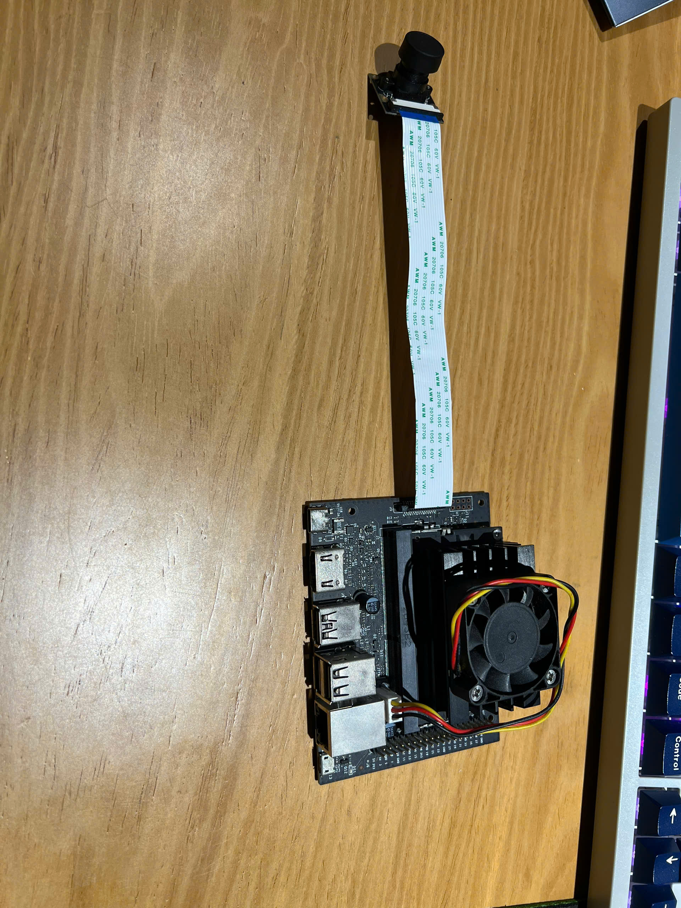
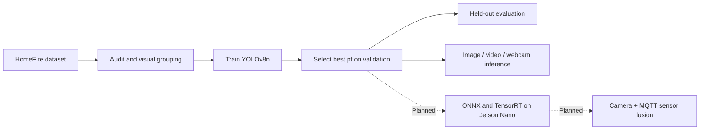
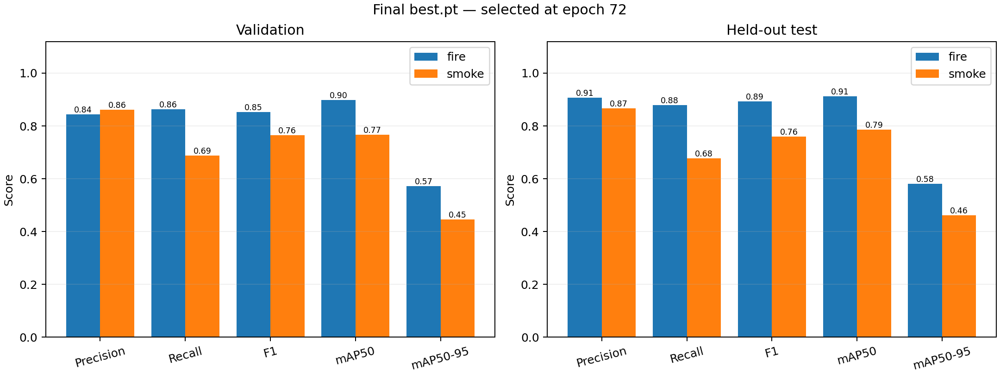
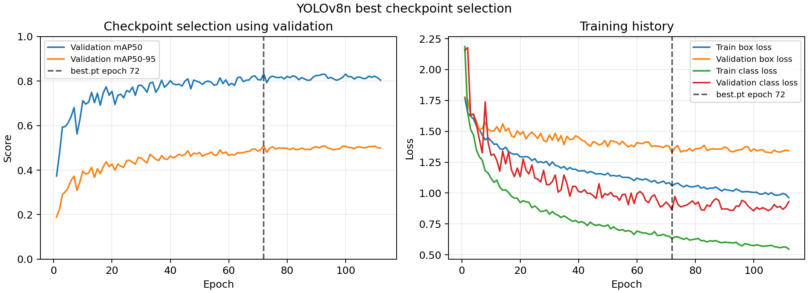

# Fire & Smoke Detection — YOLOv8n / Jetson Nano

A computer vision project that detects **fire and smoke** using a fine-tuned
YOLOv8n model. Built as part of PBL5, with **NVIDIA Jetson Nano 2GB deployment and
ESP32 sensor fusion planned as the next stage**.

**Completed:** dataset auditing, visual grouping, GPU training, held-out evaluation,
and a Python inference interface for images, videos, and webcams.
**Next:** validate the IMX219 camera, export ONNX, build TensorRT on the Jetson,
measure device performance, and integrate sensor readings over MQTT.

| Model | Test mAP50 | Test mAP50–95 | Checkpoint | Training GPU |
|---|---:|---:|---:|---|
| YOLOv8n, fire + smoke | **84.98%** | **52.11%** | **5.95 MiB** | GTX 1650 SUPER, 4GB |

## Target hardware

<p align="center">
  
</p>

The project's Jetson Nano and IMX219-160 camera are shown above. The operating
system is installed; **model deployment and Jetson FPS have not yet been verified**.
The intended sensor subsystem uses ESP32, MQ-2, DHT11, and an IR flame sensor.

## What this project implements

- Audit image/label integrity and inspect duplicate or visually similar frames.
- Keep detected visual groups together when creating train/validation/test splits.
- Fine-tune COCO-pretrained YOLOv8n for two classes: `0 = fire`, `1 = smoke`.
- Select the best checkpoint using validation mAP50–95, then evaluate on test data.
- Run streaming inference with configurable confidence, input size, and device.
- Preserve experiment settings, per-epoch metrics, model checksum, and result figures.

Ultralytics/PyTorch provide the network and optimizer implementations. This
repository contains the project-specific preparation, training, inference, and
reporting workflow.



## Results

The October 1–2, 2026 run used 6,500 HomeFire images: **3,900 train / 1,300
validation / 1,300 test**. Training stopped at epoch 112; **epoch 72** was selected.
The training loop took approximately **3 hours 8 minutes**.

| Test class | Precision | Recall | F1 | AP50 | AP50–95 |
|---|---:|---:|---:|---:|---:|
| Fire | 90.66% | 87.87% | 89.24% | 91.31% | 58.06% |
| Smoke | 86.60% | 67.69% | 75.99% | 78.66% | 46.16% |
| Class mean | 88.63% | 77.78% | 82.62% | 84.98% | 52.11% |





See the [experiment report](results/REPORT.md), [raw test metrics](results/metrics_test.json),
[training history](results/results.csv), and [test predictions](results/evaluation_test/val_batch0_pred.jpg).

**Limitations:** smoke recall is the main weakness. Visual grouping reduces
detected overlap but does not establish complete source-video independence.
These are offline dataset results; they do not establish camera accuracy,
Jetson speed, or end-to-end alarm reliability. Precision/recall/F1 use the
evaluator's operating point, not necessarily the inference default of 0.25.

## Try inference on a computer

Use Python 3.10. If you already have a working environment, activate it. Otherwise:

```bash
python3 -m venv .venv
source .venv/bin/activate
python -m pip install torch==2.5.1 torchvision==0.20.1 --index-url https://download.pytorch.org/whl/cpu
python -m pip install -r requirements.txt
python support/check_laptop.py
```

These instructions target CPU inference on Linux/Windows; they are not Jetson
installation instructions. On Windows PowerShell, activate with
`.\.venv\Scripts\Activate.ps1`. On macOS, install the same torch/torchvision
versions without the CPU index URL. GPU training needs a compatible CUDA build.

The trained checkpoint is included at `models/best.pt`; the dataset is not needed
for inference.

```bash
# Your own photo or recorded video
python predict_fire.py --source /path/to/photo.jpg --save
python predict_fire.py --source /path/to/video.mp4 --save

# Webcam; requires a working camera and graphical desktop
python predict_fire.py --source 0 --show
```

Press **q** in the display window or **Ctrl+C** to stop. Predictions are written
under `results/predictions/`. Saved dataset evaluation examples are available
in [results/evaluation_test/](results/evaluation_test/) for inspection.

## Training and data preparation

The dataset is intentionally excluded. Place your local HomeFire copy at
`HomeFire/` in this repository, with `train`, `val`, and `test` image/label folders.
Obtain the COCO initialization from the pinned source in [models/SOURCE.md](models/SOURCE.md)
and save it as `models/yolov8n.pt`; its expected checksum is recorded there.

```bash
python support/audit_homefire.py
python support/group_homefire.py
python train_local.py --name homefire_v2
```

The grouping script writes `HomeFire/data_grouped.yaml` and image lists. The
training script uses 640 input, batch 8, FP32, AdamW, seed 42, patience 40, and an
eight-hour cap. Training requires a CUDA-capable GPU. The [configuration examples](config_examples/README.md)
explain the difference between directory splits and grouped image lists.

The current training entry point was simplified after the experiment for
readability. The [original training source](support/history/original_scripts/train_local.py)
is an archival snapshot, not the current entry point. Recorded settings remain in
[results/args.yaml](results/args.yaml). Original split manifests are absent from
this transfer package; regenerating splits requires the same dataset and should
be audited before claiming exact reproduction of the published scores.

## Repository layout

```text
├── predict_fire.py       # Image, video, and webcam inference
├── train_local.py        # Training and best-checkpoint evaluation
├── requirements.txt      # Project dependencies; install PyTorch separately
├── models/               # Trained best.pt and pretrained-model provenance
├── config_examples/      # Dataset YAML examples
├── support/              # Audit, grouping, checks, metrics, source history
├── results/              # Recorded metrics, settings, plots, examples
├── pictures/             # Jetson/camera and ESP32 hardware photographs
└── docs/                 # Deployment roadmap
```

## Deployment roadmap

- [x] Train and evaluate YOLOv8n on the desktop GPU.
- [x] Package model weights, inference code, and experiment evidence.
- [ ] Verify JetPack/TensorRT versions and the IMX219 camera.
- [ ] Export ONNX and verify predictions against PyTorch.
- [ ] Build a TensorRT engine on the Jetson Nano; benchmark input sizes.
- [ ] Measure camera latency, FPS, RAM usage, and missed detections.
- [ ] Integrate timestamped ESP32 readings over MQTT and evaluate alarm behavior.

See [the deployment roadmap](docs/DEPLOYMENT.md). Hardware optimization and sensor
fusion are future milestones, not completed results.

## Acknowledgments

Built with [Ultralytics YOLOv8](https://github.com/ultralytics/ultralytics),
[PyTorch](https://pytorch.org/), OpenCV, NumPy, Pillow, and PyYAML.
The underlying frameworks, pretrained weights, and dataset retain their
respective licenses and terms. HomeFire images and labels are not distributed
here; saved evaluation figures contain example thumbnails used in the report.
