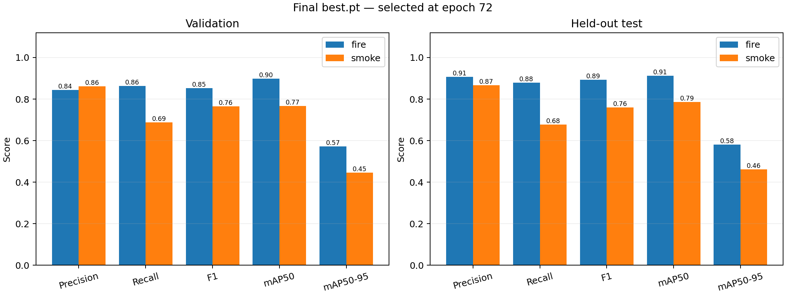
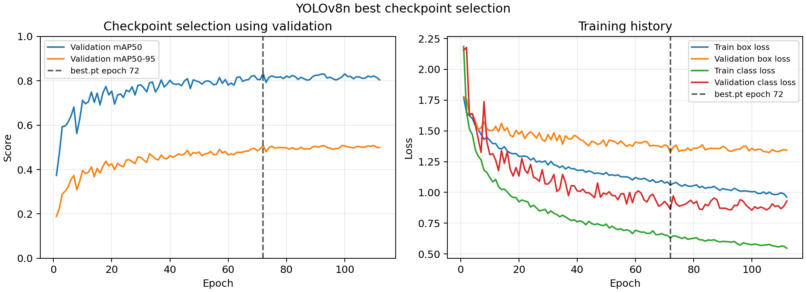

# Final fire and smoke detection results

This report describes the completed October 1–2, 2026 experiment. The source code
was later simplified for presentation; the model and these recorded metrics are unchanged.

## Selected model

- Model: **YOLOv8n**, fine-tuned from COCO pretrained weights.
- Classes: **fire (0)** and **smoke (1)**.
- Weights for the demo: [models/best.pt](../models/best.pt).
- Best checkpoint: **epoch 72**, selected by validation mAP50–95.
- Training ended at epoch **112** after 40 epochs without improvement.
- Training loop: **3 hours 7 minutes 50 seconds**; evaluation finished October 2 at 01:24 Vietnam time.
- Parameters before layer fusion: **3,011,238**; checkpoint size: **5.95 MiB**.
- Resolution: 640; batch: 8; FP32; AdamW; initial learning rate: 0.001; seed: 42.
- Maximum training budget: 8 hours, with a requested 1,000-epoch ceiling. Timed mode adjusted the effective epoch target.

## Final best.pt metrics

All numbers below are percentages. The `all` rows are means over the two classes.

| Split | Class | Precision | Recall | F1 | mAP50 | mAP50–95 |
|---|---|---:|---:|---:|---:|---:|
| Validation | All | 85.26 | 77.52 | 80.90 | 83.29 | 50.92 |
| Validation | Fire | 84.40 | 86.29 | 85.34 | 89.84 | 57.30 |
| Validation | Smoke | 86.11 | 68.75 | 76.46 | 76.75 | 44.54 |
| Test | All | 88.63 | 77.78 | 82.62 | 84.98 | 52.11 |
| Test | Fire | 90.66 | 87.87 | 89.24 | 91.31 | 58.06 |
| Test | Smoke | 86.60 | 67.69 | 75.99 | 78.66 | 46.16 |

Precision/recall/F1 use Ultralytics' evaluation operating point, not a fixed
confidence threshold of 0.5. mAP is an object detection metric, not image
classification accuracy. Test data was evaluated after checkpoint selection.



## Learning history

The vertical marker identifies the selected checkpoint. The curve includes all
training epochs; the final tables above describe best.pt alone.



## Dataset and limitations

| Split | Images | Fire boxes | Smoke boxes |
|---|---:|---:|---:|
| Train | 3,900 | 2,910 | 1,964 |
| Validation | 1,300 | 912 | 656 |
| Test | 1,300 | 1,016 | 520 |

The grouped split reduced detected overlap between similar images. Original
source-video IDs are unavailable, so complete scene independence is unverified.
The earlier Colab run used different splits; its higher scores are not a direct
comparison with this experiment. Smoke recall remains weaker than fire recall.
Actual camera performance and Jetson speed require separate measurement.

## Evidence to show

- [Test confusion matrix](evaluation_test/confusion_matrix.png)
- [Test precision–recall curve](evaluation_test/BoxPR_curve.png)
- [Test predicted examples](evaluation_test/val_batch0_pred.jpg)
- [Test annotations for those examples](evaluation_test/val_batch0_labels.jpg)
- [All training curves](results.png)
- [Epoch metrics CSV](results.csv)
- [Exact test metrics](metrics_test.json) and [validation metrics](metrics_val.json)
- [Recorded training configuration](args.yaml) and [environment](environment.json)
- [Original training source](../support/history/original_scripts/train_local.py)

Some original metadata retains absolute paths from before folder cleanup; the
dataset is omitted from this laptop package. Configuration examples are in config_examples/; inference uses models/best.pt directly.

Checkpoint SHA256:

```text
736629455959a482400e68fdd93d7149f2a2b65b2dfb432f9c26598108b18a1c
```
